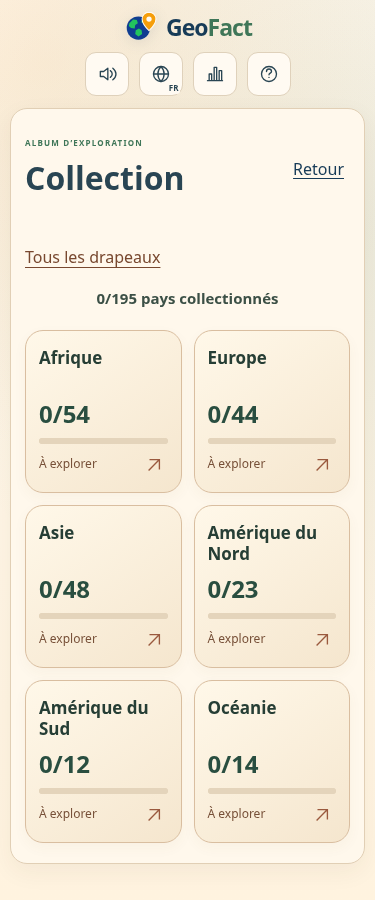
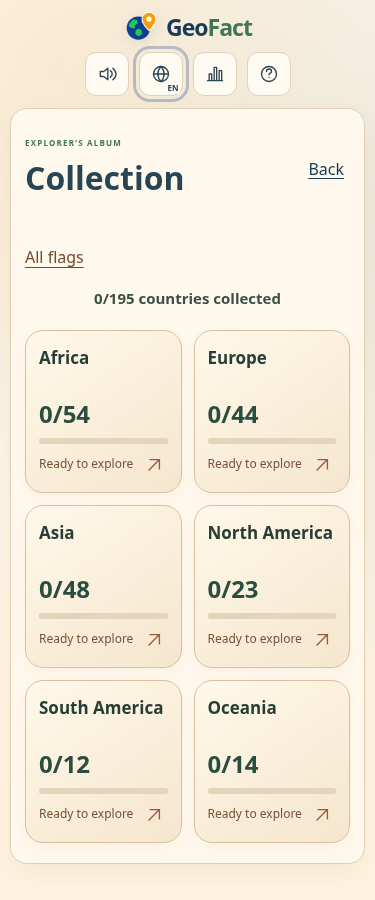
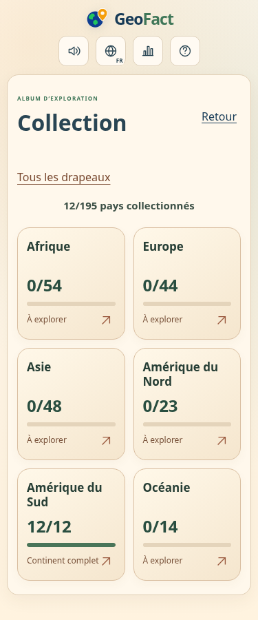
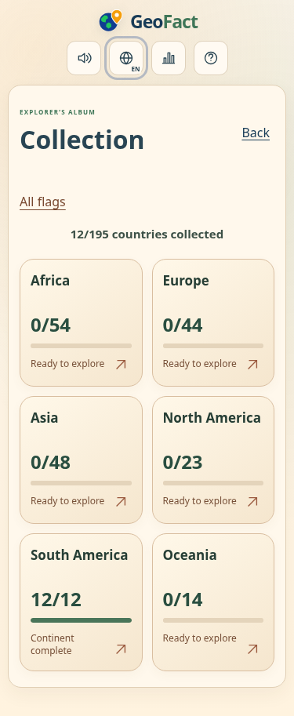

# GeoFact — aperçu de l’album par continents

Captures de la branche de développement, avec des sauvegardes fictives. Aucun déploiement du jeu. Ordinateur : 1280 px ; mobile : 375 px.

## Album en français

## Album in English

## Dans un continent / Inside a continent

## Récompenses / Rewards

## Collection vide ou continent complet / Empty or complete

[Download all 20 screenshots / Télécharger les 20 captures](../album-preview.zip).

Validation: 105 Node tests, 3,788 full HTTP browser assertions, 357 album assertions and 21 persistent restart assertions passed. Chromium desktop/mobile, Supabase mocked. Physical phones and WebKit unavailable. The game remains undeployed on the development branch.
